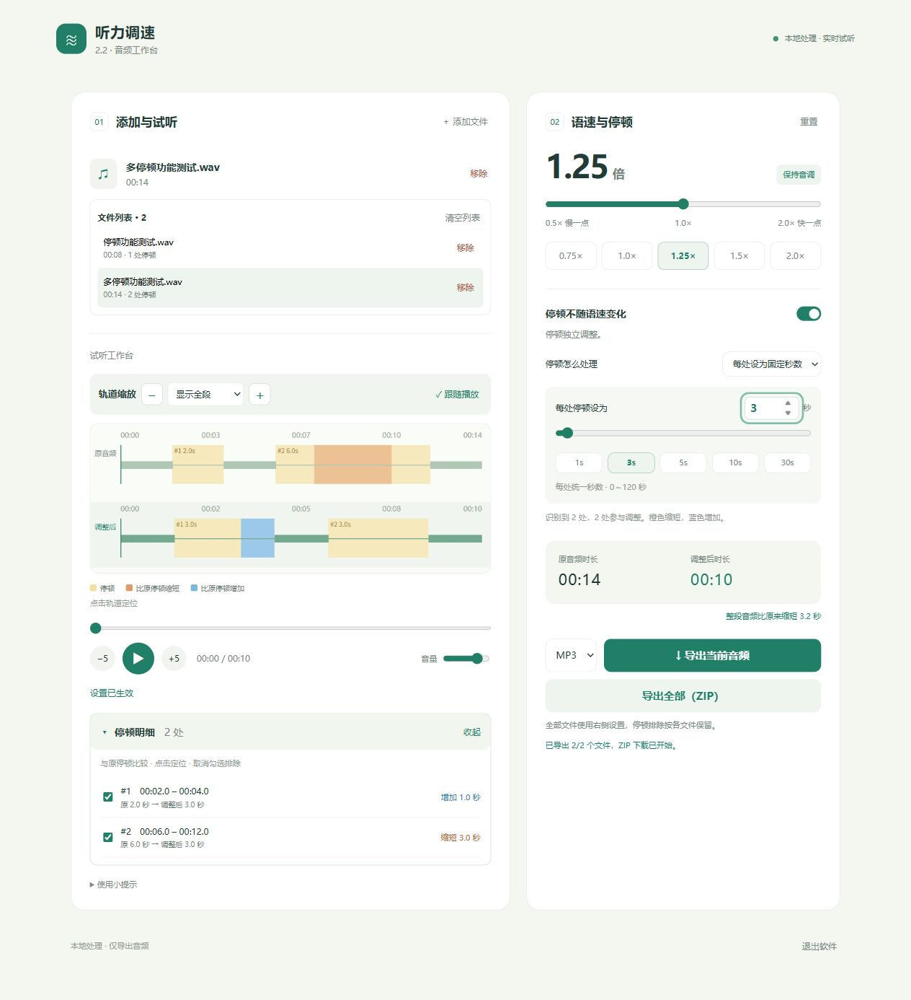

# 听力调速

给英语老师用的本地音频工具：调整听力语速，给学生留出合适的答题时间，边听边调，满意后导出。

支持导入音频和 MP4 等视频；视频只提取音轨，最终只导出音频。文件全程在电脑上处理。



## 下载与使用

到 [最新 Release](https://github.com/RanTian2333/listening-speed/releases/latest) 下载 Windows 64 位版本：

- `ListeningSpeed-2.2-Windows-x64.exe`：双击运行，无需安装 Python 或 FFmpeg。
- `ListeningSpeed-2.2-Windows-portable.zip`：软件、使用说明、示例、应用源码及第三方许可。

软件启动后在浏览器中打开工作台，需要现代浏览器。

1. 选择或拖入音频 / 视频，可一次添加多个文件。
2. 调整右侧语速，点击 ▶ 实时试听。
3. 如需保留答题时间，打开“停顿不随语速变化”，选择保持原秒数或独立调整停顿。
4. 导出当前音频，或用同一套设置批量导出 ZIP。

详细操作见 [使用说明](使用说明2.2.md)。

## 功能

| 功能 | 说明 |
| --- | --- |
| 语速 | 0.5～2 倍，保持音调，播放中可调整 |
| 停顿保持 | 讲话变速，已识别的停顿保留原秒数 |
| 停顿倍数 | 以原停顿为基准，0～20 倍 |
| 固定停顿 | 每处统一为 0～120 秒 |
| 最长停顿 | 只缩短超过设定上限的停顿 |
| 轨道 | 原音频 / 调整后对照、缩放、点击定位、跟随播放 |
| 停顿明细 | 原秒数 → 当前秒数、增减颜色、定位、排除误识别 |
| 文件列表 | 多文件导入、切换试听、移除、清空，最多 100 个 |
| 导出 | MP3 / WAV，单个导出或批量 ZIP，不覆盖原文件 |

**语速与停顿独立控制的例子：**原停顿 4 秒，语速设为 2 倍，选择“保持原秒数”后停顿仍为 4 秒；停顿设为 1.5 倍则变成 6 秒。蓝色“增加 2 秒”始终相对于原来的 4 秒。

“轨道缩放”只改变可见时间范围，不影响播放速度。点击上方原音频轨道也只定位内容，试听始终采用右侧设置。

批量导出使用点击按钮时的统一设置，各文件排除的停顿分别保留。ZIP 中加入编号以避免同名覆盖；失败文件会提示，其余文件继续处理。

## 支持格式与限制

- 音频：MP3、WAV、M4A、AAC、FLAC、OGG、WMA。
- 视频：MP4、MOV、MKV、WebM、AVI，提取第一条音轨；加密文件或无音轨视频不支持。
- 每个文件最大 1 GB，音轨最长 2 小时。
- MP3 输出 192 kbps；WAV 输出 44.1 kHz、16 bit、双声道。
- 自动识别至少 1.2 秒、低于 −42 dB 的中间安静片段，保留开头和结尾。轻声可能误识别，背景音乐可能导致漏识别，可在明细中排除。
- 首次读取及导出需要处理时间；读取完成后试听无需先渲染整段音频。
- 试听和导出使用同样的时间规则，但保音调算法不同，音色和边界可能有细微差别。试听时请保持页面打开。

## 从源码运行

项目使用 Python 标准库、原生 HTML / CSS / JavaScript，没有前端构建步骤。

Windows 上准备 Python 3.11 和 FFmpeg，将 FFmpeg 可执行文件放到 `bin/ffmpeg.exe`；也支持在 PATH 中查找 FFmpeg。

```powershell
python app.py
```

启动后只监听 `127.0.0.1` 的随机端口，页面和接口使用随机访问令牌。点击“退出软件”清理临时文件；关闭页面约 5 分钟无操作后自动退出。

| 文件 | 职责 |
| --- | --- |
| `app.py` | 本地 HTTP 服务、上传、音轨提取、停顿识别、导出和 ZIP |
| `timeline.py` / `timeline.js` | 前后端一致的时间规划和映射 |
| `player.js` | 实时保音调播放和可调整的停顿等待 |
| `ui.js` | 文件列表、轨道、设置、批量导出 |
| `index.html` / `style.css` / `extra.css` | 工作台界面 |

## 验证与打包

运行音频测试需要 FFmpeg，播放逻辑测试需要 Node.js。示例文件为纯音，建议低音量试听。

```powershell
python tests/test_audio.py
node tests/test_player.js
python tests/smoke.py
```

验证包括变速时长与音调、停顿保持 / 延长 / 缩短 / 排除、MP4 提取、实时播放时间映射、批量 ZIP、同名文件及移除隔离。

Windows 打包：

```powershell
python -m pip install PyInstaller==6.22.3
python -m PyInstaller --noconfirm --onefile --windowed --name "听力调速2.2" --distpath release22 --add-binary "bin/ffmpeg.exe;bin" --add-data "index.html;." --add-data "timeline.js;." --add-data "player.js;." --add-data "ui.js;." --add-data "style.css;." --add-data "extra.css;." app.py
python tests/smoke.py --exe
```

FFmpeg 是单独调用的未修改第三方程序；Release 中包含其许可及 Python、PyInstaller 的许可。版本和来源见 [第三方说明](THIRD_PARTY_NOTICES.md)。
